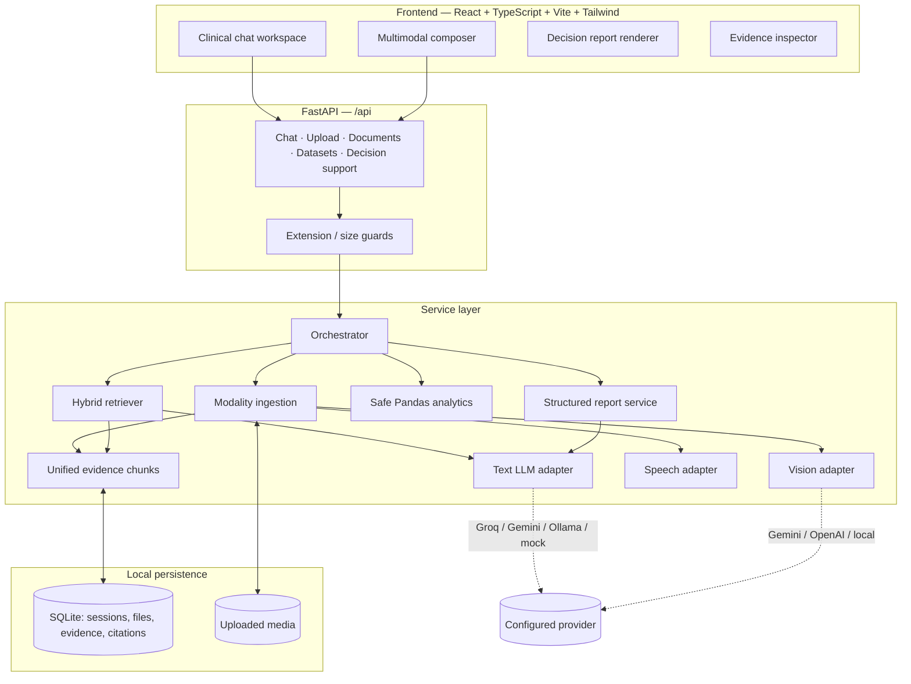
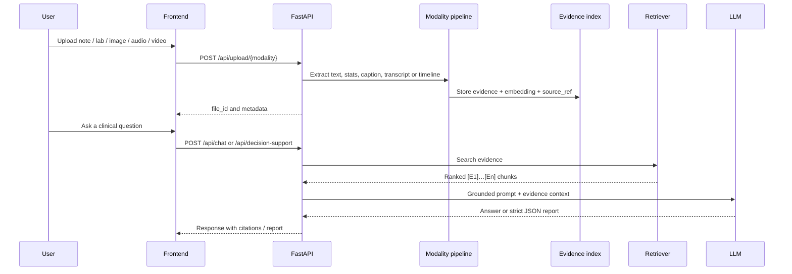

# MedReason — Multimodal AI Assistant for Intelligent Decision Support

> **Academic demonstration only — not for clinical use.** Use synthetic or de-identified records exclusively. This project is a capstone prototype for studying multimodal retrieval and evidence-grounded language generation. It is **not** a medical device and must never inform patient care.


---

## Plain-language summary

Imagine a clinician has a folder containing a progress note, a lab spreadsheet, an image of a chart, a voice recording and a short video. Asking one question across all of those files is difficult because each file has a different format.

**MedReason solves that by turning every file into searchable “evidence”.** When you ask a question, the system:

1. searches all uploaded evidence,
2. picks the most relevant passages from any modality,
3. gives those passages to a language model as **proof**,
4. returns an answer with clickable citations such as `[E1]`, and
5. can build a structured decision brief with options, risks and next steps.

The important idea is **grounding**: the assistant is not allowed to invent medical facts. If the uploaded evidence does not contain the answer, the app says so.

---

## Capstone brief → implementation mapping

The brief asked for a multimodal AI assistant able to understand and integrate **text, voice, images, videos and structured data** for context-aware responses and intelligent decision support, using **VLMs, LLMs, speech recognition and knowledge retrieval**.

| Brief requirement | How this project addresses it | Honest scope |
| :--- | :--- | :--- |
| Text understanding | PDF/DOCX/TXT/Markdown ingestion, chunking and retrieval | Retrieval over uploaded documents only |
| Voice interaction | Browser microphone upload, ASR transcription, timestamped segments | Optional Whisper; offline placeholder fallback |
| Image understanding | Gemini VLM captions, OpenCV statistics, palette and optional OCR | Captions are evidence, not diagnoses |
| Video understanding | OpenCV interval frames with timestamped timeline events | Frame sampling, not temporal video transformers |
| Structured data | Safe Pandas analytics for CSV/Excel with charts | Deterministic max/min/mean/count/null queries |
| Knowledge retrieval | Unified `EvidenceChunk` index with hybrid dense + lexical scoring | Local SQLite index, not a distributed vector database |
| LLM decision support | Groq-generated structured JSON reports; Gemini/Ollama/mock alternatives | Offline mode produces an evidence inventory, not clinical advice |
| Healthcare & Medical domain | Clinical theme, synthetic DEMO-001 records, academic disclaimer | No real patient data, no clinical validation |
| AI frameworks | scikit-learn for stable embeddings/clustering; optional sentence-transformers (PyTorch) | TensorFlow/PyTorch are not required to run the prototype |
| Free software/APIs | FastAPI, React, SQLite, scikit-learn, Groq free tier, Gemini free tier, optional local Whisper | API keys are user-supplied and stored only in local `.env` |

---

## What the app can do

| Capability | What happens internally | What you see |
| :--- | :--- | :--- |
| **Unified multimodal RAG** | Every upload becomes an `EvidenceChunk` with text, source reference, modality and embedding | One evidence layer for all file types |
| **Hybrid retrieval** | `0.75 × dense cosine similarity + 0.25 × lexical IDF overlap` | Relevant chunks ranked and cited |
| **Grounded answers** | Evidence is injected into the prompt as `[E1]`, `[E2]`, … | Answer with citation chips and a source inspector |
| **Decision briefs** | LLM returns strict JSON with findings, alternatives, risks and next steps | Structured report card, not a generic chatbot reply |
| **Lab analytics** | Safe Pandas planner with no `eval()` or `exec()` | Exact numbers, calculation basis and chart suggestions |
| **Image analysis** | Gemini VLM when configured; local OpenCV/Tesseract fallback otherwise | Caption, dimensions, palette and extracted text |
| **Audio analysis** | Optional Whisper with segments; local recognizer fallback | Transcript with timestamps |
| **Video analysis** | Keyframes extracted every few seconds | Timeline events and video summary |

### Example interaction

**User**

> What does the plan say about the thyroid panel and palpitations?

**MedReason**

> The plan is to review the complete blood count and thyroid panel `[E1]`, repeat heart-rate monitoring after two weeks `[E1]`, and escalate to specialist review if palpitations persist or worsen `[E1]`.
>
> Academic demonstration only — not for clinical use.

`[E1]` opens the exact note snippet in the Evidence Inspector.

---

## Architecture



### Evidence flow



---

## Tech stack

| Layer | Technology | Why it was chosen |
| :--- | :--- | :--- |
| Frontend | React 18, TypeScript, Vite | Fast, type-safe interactive workspace |
| Styling | Tailwind CSS | Consistent clinical dark theme and responsive layout |
| Charts | Recharts | Native rendering of dataset chart specs |
| Backend | FastAPI, Uvicorn | Async REST API with automatic OpenAPI docs |
| Database | SQLite + SQLAlchemy | Zero-configuration local persistence |
| Analytics | Pandas, NumPy | Verifiable statistics without arbitrary code execution |
| Embeddings | scikit-learn HashingVectorizer | Deterministic, dependency-light, stable query/chunk vectors |
| Optional embeddings | sentence-transformers | Better semantic retrieval when installed |
| Vision | OpenCV, Pillow, Tesseract, Gemini VLM | Local processing plus optional generative captions |
| Speech | SpeechRecognition, optional faster-whisper | Free/offline-first transcription path |
| Text generation | Groq, Gemini, OpenAI-compatible, Ollama, mock | Configurable providers with a no-key fallback |

---

## Repository layout

```text
MedReason/
├─ backend/
│  ├─ app/
│  │  ├─ api/endpoints/        # chat, upload, documents, datasets, decision support
│  │  ├─ models/db_models.py   # FileRecord, EvidenceChunk, conversations, messages
│  │  ├─ repositories/         # hybrid vector search, files, conversations
│  │  ├─ schemas/              # Pydantic request/response models
│  │  ├─ services/             # LLM, VLM, speech, video, analytics, decision, orchestrator
│  │  ├─ config.py             # environment-driven settings
│  │  └─ main.py               # FastAPI app, CORS, health, static media
│  ├─ data/assistant.db        # SQLite database (created at startup)
│  ├─ data/uploads/            # Uploaded files and extracted frames
│  ├─ tests/test_system.py     # 9 end-to-end API tests
│  └─ .env                     # Local secrets — never committed
├─ frontend/
│  ├─ src/components/          # Sidebar, chat, composer, report, drawers, modals
│  ├─ src/services/api.ts      # Axios client (defaults to :8000)
│  └─ .env.example             # Optional VITE_API_URL override
├─ data/sample_data/clinical/  # Synthetic clinical fixtures
├─ .env.example                # Backend configuration template
├─ README.md                   # This file
└─ USER_AND_TEST_GUIDE.md      # Step-by-step usage and manual testing guide
```

---

## Quick start

### Prerequisites

- Python 3.11+
- Node.js 18+ / 20+ / 22+
- npm 9+ or 10+

### 1. Configure

```powershell
cd "D:\pbl ly"
Copy-Item .env.example backend\.env
```

The template is offline-safe:

```env
LLM_PROVIDER=mock
VISION_PROVIDER=gemini      # no key -> local visual fallback
SPEECH_PROVIDER=local
EMBEDDING_PROVIDER=hashing_cosine
```

### 2. Backend

```powershell
cd "D:\pbl ly\backend"
python -m pip install -r requirements.txt
python -m uvicorn app.main:app --host 127.0.0.1 --port 8000 --reload
```

- API: <http://127.0.0.1:8000/api>
- Health: <http://127.0.0.1:8000/api/health>
- Swagger docs: <http://127.0.0.1:8000/docs>

### 3. Frontend

```powershell
cd "D:\pbl ly\frontend"
npm install
npm run dev
```

- App: <http://localhost:5173>

The frontend defaults to `http://127.0.0.1:8000/api`. To override it, copy `frontend/.env.example` to `frontend/.env`.

---

## Using free APIs

Edit `backend/.env` and restart the backend after changes.

### Recommended: Groq for text + Gemini for vision

```env
LLM_PROVIDER=groq
LLM_MODEL=qwen/qwen3.8-27b
LLM_API_KEY=YOUR_GROQ_API_KEY

VISION_PROVIDER=gemini
VISION_MODEL=gemini-flash-lite-latest
VISION_API_KEY=YOUR_GEMINI_API_KEY
```

`VISION_API_KEY` is separate so both free providers can be active simultaneously. If it is blank, the vision adapter falls back to `LLM_API_KEY`.

Model IDs are provider-controlled and may change. If a provider returns `model_not_found`, query its `/models` endpoint and update the model name.

### Other text providers

```env
# Gemini for both text and vision
LLM_PROVIDER=gemini
LLM_MODEL=gemini-flash-lite-latest
LLM_API_KEY=YOUR_GEMINI_API_KEY

# OpenAI-compatible endpoint
LLM_PROVIDER=openai
LLM_MODEL=gpt-4o-mini
LLM_API_KEY=YOUR_OPENAI_KEY

# Fully local Ollama
LLM_PROVIDER=ollama
LLM_MODEL=llama3
```

### Optional local Whisper

```powershell
python -m pip install faster-whisper
```

```env
SPEECH_PROVIDER=whisper
WHISPER_MODEL=base
```

### Optional semantic embeddings

```env
EMBEDDING_PROVIDER=local_transformers
EMBEDDING_MODEL=all-MiniLM-L6-v2
```

The default `hashing_cosine` provider requires no model download.

---

## Synthetic clinical fixtures

All files in `data/sample_data/clinical/` are fabricated for demonstration and contain no real patient information.

| File | Purpose | Useful test facts |
| :--- | :--- | :--- |
| `clinical_note.txt` | DEMO-001 follow-up note | Fatigue, palpitations, thyroid panel and escalation plan |
| `lab_results.csv` | Serial lab table | 8 rows, 5 columns, max hemoglobin 14.8 |
| `vitals_chart.png` | Trend chart | 400×300, title `SYNTHETIC VITALS TREND` |
| `consultation_audio.wav` | Audio placeholder | About 4 seconds |
| `procedure_clip.mp4` | Video timeline | About 6 seconds |

Older generic filenames at the top level of `data/sample_data/` contain the same clinical data for backward compatibility.

---

## How to demo the project

1. Open the app and click **New clinical case**.
2. Upload `clinical_note.txt`.
3. Ask: “What does the plan say about the thyroid panel and palpitations?”
4. Open the **Evidence** panel and inspect `[E1]`.
5. Upload `lab_results.csv`.
6. Ask: “What is the highest Hemoglobin_g_dL in this dataset?” Expected: **14.8**.
7. Upload `vitals_chart.png` and ask for a description.
8. Upload `consultation_audio.wav` and `procedure_clip.mp4`.
9. Enable **Decision Brief** and ask:

   > For DEMO-001 with fatigue and palpitations, compare continued monitoring, targeted workup, and specialist review. Recommend the safest next step using only the uploaded evidence.

10. Show the structured report with alternatives, risks, recommendation and evidence sources.

A full prompt pack and 20-case manual test matrix are in [`USER_AND_TEST_GUIDE.md`](USER_AND_TEST_GUIDE.md).

---

## API surface

| Endpoint | Purpose |
| :--- | :--- |
| `GET /api/health` | Service status and configured providers |
| `POST /api/chat` | Unified chat/decision routing with citations |
| `POST /api/upload/document` | Ingest PDF, DOCX, TXT or Markdown |
| `POST /api/upload/image` | VLM/local image analysis and evidence indexing |
| `POST /api/upload/audio` | ASR transcription and timestamped evidence |
| `POST /api/upload/video` | Frame extraction and timeline evidence |
| `POST /api/upload/dataset` | CSV/Excel schema, stats, charts and evidence |
| `POST /api/documents/query` | Grounded document query with citations |
| `POST /api/datasets/query` | Deterministic safe Pandas calculation |
| `POST /api/decision-support` | Structured evidence-backed decision brief |

See `/docs` for full request/response schemas.

---

## Tests

```powershell
cd "D:\pbl ly\backend"
python -m pytest tests/test_system.py -v
```

Expected: **9 passed**.

The suite covers health, text chat, document RAG, image analysis, audio ingestion, lab analytics, video frame extraction, decision-brief structure and unsupported-extension rejection. It is forced offline by `backend/tests/conftest.py`, so it never spends API quota.

Frontend build check:

```powershell
cd "D:\pbl ly\frontend"
npm run build
```

---

## Design decisions

- **Evidence first:** retrieval happens before response generation for every modality.
- **No fabricated features:** no streaming claim, no production claim, no hidden medical knowledge base and no hardcoded clinical recommendations.
- **Grounded prompting:** evidence is passed as `[E1]…[En]`; the system prompt forbids unsupported medical facts and requires the academic disclaimer.
- **Honest degradation:** missing keys or provider failures fall back to clearly labelled local behaviour.
- **Dataset calculations stay exact:** deterministic Pandas results are added as cited evidence rather than replacing retrieval.
- **Clinical UI:** dark navy/violet/teal workspace with evidence chips, report cards, media-aware composer and evidence inspector, inspired by Linear, Vercel/Stripe, ChatGPT/Claude and Apple Health.

---

## Limitations

1. Academic prototype only; not validated, certified or safe for clinical use.
2. Answers are limited to uploaded evidence, which may be incomplete or mis-ranked.
3. Image captions, transcripts and video timelines are metadata, not verified clinical observations.
4. Offline decision reports are evidence inventories; structured recommendations require a configured LLM.
5. Video understanding samples frames at intervals; it does not model continuous temporal events.
6. Tesseract and Whisper are optional and their fallbacks are lower fidelity.
7. SQLite and local file storage suit demonstration, not multi-user deployment.
8. Do not upload real patient data.

---

## Documentation

- [`USER_AND_TEST_GUIDE.md`](USER_AND_TEST_GUIDE.md) — usage tutorial, prompts, manual test matrix and troubleshooting.
- [`backend/tests/test_system.py`](backend/tests/test_system.py) — automated integration tests.
- FastAPI Swagger UI — <http://127.0.0.1:8000/docs> when the backend is running.

---

**Academic demonstration only — not for clinical use.**
